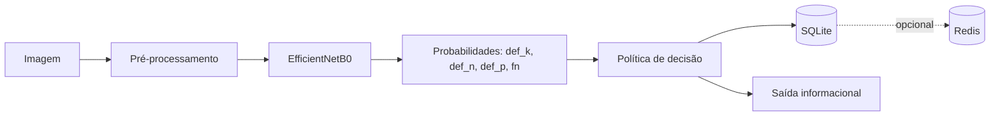

# FNNPK — classificação visual e agente com memória para alface

[](https://github.com/pammelavicenti/fnnpk-artigo-reproducibilidade/actions/workflows/verificacao.yml)
[](LICENSE)

Este repositório reúne código, configurações, manifestos e resultados pequenos
de apoio a uma pesquisa sobre classificação visual de possíveis deficiências de
nitrogênio, fósforo e potássio em alface. Também inclui um agente experimental
que mantém estado entre observações e decide quando registrar uma suspeita,
solicitar nova captura, emitir um alerta informacional ou encaminhar o caso para
revisão.

As saídas representam **suspeitas visuais**, não diagnósticos agronômicos nem
recomendações de adubação. Dataset e modelos treinados não são distribuídos.

## Comece aqui

Para verificar a parte reproduzível sem instalar TensorFlow, baixar dados ou usar
GPU/Redis:

```powershell
git clone https://github.com/pammelavicenti/fnnpk-artigo-reproducibilidade.git
cd fnnpk-artigo-reproducibilidade
python scripts/verificar_reproducibilidade.py
```

O comando executa os testes do agente, a demonstração funcional, a comparação de
políticas e verificações de integridade em diretórios temporários. O resultado
esperado termina com:

```text
[APROVADO] Todas as verificações básicas foram concluídas.
```

Depois, escolha o guia adequado:

- [Instalação e ambientes](docs/INSTALACAO.md)
- [Reprodução em três níveis](docs/REPRODUCAO.md)
- [Metodologia e arquitetura](docs/METODOLOGIA.md)
- [Rastreabilidade de resultados](docs/RASTREABILIDADE.md)
- [Limitações e materiais ausentes](docs/PENDENCIAS_REPRODUCAO.md)
- [Relatório de verificação](docs/RELATORIO_FINAL.md)

## Problema científico

Sintomas foliares podem produzir padrões visuais associados a condições
nutricionais, mas imagem, rótulo do dataset e estado agronômico não são conceitos
equivalentes. O projeto investiga duas questões separadas:

1. como um classificador de imagens distingue quatro classes visuais registradas;
2. como uma política com memória transforma previsões sucessivas em decisões
   informacionais, evitando repetir alertas a cada observação.

O repositório não demonstra que essas decisões melhoram o cultivo, reduzem falsos
positivos ou substituem avaliação agronômica.

## Objetivos documentados

- preparar e dividir imagens em classes `def_k`, `def_n`, `def_p` e `fn`;
- treinar e comparar classificadores EfficientNetB0;
- preservar configurações, históricos e métricas de experimentos;
- avaliar, de forma exploratória, modelos no conjunto chamado teste;
- verificar uma política temporal com estado persistente em SQLite;
- comparar essa política com uma referência de alerta imediato;
- tornar claras as evidências disponíveis e as lacunas de reprodução.

## Visão geral da arquitetura



O fluxo real, as regras de estado e as etapas experimentais são detalhados no
[guia metodológico](docs/METODOLOGIA.md).

## Organização das pastas

| Caminho | Finalidade |
| --- | --- |
| `scripts/` | preparação dos dados e verificação automatizada |
| `FNNPK_preparacao/` | código de treino/avaliação e artefatos históricos |
| `FNNPK_preparacao/agente_visao_v1/` | agente, cenários, testes e exemplos |
| `FNNPK_preparacao/comparacao_politicas/` | comparação descritiva sobre percepções fixas |
| `FNNPK_preparacao/comparacao_validacao_seed321/` | seleção exploratória em validação |
| `FNNPK_preparacao/comparacao_sementes_C_V2_*/` | comparação de três sementes em duas condições |
| `FNNPK_preparacao/C_sinteticas_*/` | experimentos com imagens sintéticas |
| `FNNPK_sintetico_piloto/`, `FNNPK_sintetico_v2/` | metadados dos lotes sintéticos |
| `docs/` | instalação, reprodução, método, auditoria e inventários |
| `requirements/` | versões históricas por ambiente; não são um ambiente universal |

Pastas com datas, sementes e cópias de scripts executados foram mantidas para
preservar a proveniência. Repetição nesses diretórios não significa que os
arquivos devam ser removidos ou unificados.

## Tecnologias confirmadas

- Python e biblioteca padrão;
- TensorFlow/Keras e EfficientNetB0;
- NumPy, scikit-learn e Matplotlib;
- Pillow para imagens;
- SQLite para estado persistente;
- Redis como publicação opcional;
- rembg/ONNX Runtime em um ambiente separado de recorte.

O treinamento principal registra Python 3.11.17, TensorFlow 2.17.1, Keras 3.15.1,
NumPy 1.26.4 e scikit-learn 1.9.1. O recorte registra outro ambiente, com NumPy
2.4.6. Consulte [Instalação](docs/INSTALACAO.md) antes de instalar dependências.

## Demonstração sem dataset

O comando central é a rota recomendada. Para observar somente os testes:

```powershell
python -m unittest discover -s FNNPK_preparacao/agente_visao_v1 -v
```

Os doze testes verificam persistência, concordância, idempotência, conflitos de
identificadores, capturas repetidas, ordem temporal, expiração, troca de modelo,
entradas inválidas, empate e retomada de publicação simulada. Eles não carregam
modelo Keras nem conectam a Redis real.

## Preparação dos dados

O dataset original não está neste repositório. Sua URL, versão e licença exatas
não foram encontradas nos materiais. Se você tiver uma cópia obtida legalmente,
organize as classes originais como `-K`, `-N`, `-P` e `FN`, configure os caminhos
e execute:

```powershell
$env:FNNPK_ORIGEM = 'C:\dados\FNNPK'
$env:FNNPK_PREPARACAO = 'C:\trabalho\FNNPK_preparacao'
python scripts/preparar_base.py
python scripts/conferir_imagens.py
python scripts/dividir_base.py
```

Os manifestos usam hashes e agrupamentos visuais provisórios. Isso não comprova
independência biológica por planta ou sequência de captura.

## Treinamento e avaliação

O procedimento histórico usa EfficientNetB0 com pesos ImageNet, duas fases de
treinamento, aumento de dados, pesos por classe, AdamW e seleção por validação.
A implementação atual do treinamento exige GPU. Antes de executar, leia os guias
de [instalação](docs/INSTALACAO.md) e [reprodução](docs/REPRODUCAO.md).

Os modelos `.keras` foram excluídos. Treinar novamente reproduz o procedimento
disponível, não os pesos históricos exatos. As avaliações em pastas chamadas
`avaliacao_teste` e `avaliacao_exploratoria_teste*` são exploratórias porque o
mesmo conjunto de 31 imagens foi consultado durante o desenvolvimento.

## Agente inteligente

O agente usa SQLite para manter estado por `planta_id`. A primeira suspeita pede
outra captura. Uma segunda captura com bytes diferentes, mesma classe e mesma
versão de modelo, dentro da janela padrão de 24 horas, produz um alerta
informacional. Divergência, empate ou `fn` após suspeita encaminham para revisão.

A janela de 24 horas é uma escolha de engenharia provisória. Não existe limiar de
“confiança” calibrada, e hashes distintos não garantem imagens independentes.
Redis é opcional e a entrega é pelo menos uma vez.

## Comparação das políticas

A comparação usa cinco percepções fixas: quatro associadas a imagens de validação
e uma entrada inválida. Não há nova inferência. Nessa sequência, a referência
imediata produz quatro alertas e o agente com estado produz um. A diferença é
operacional; não representa redução comprovada de falsos positivos.

```powershell
cd FNNPK_preparacao/comparacao_politicas
python comparar_politicas.py --entrada entrada_cenario.jsonl `
  --saida "$env:TEMP/comparacao_resultados.json"
cd ../..
```

## Resultados preservados

| Resultado | Classificação correta | Evidência |
| --- | --- | --- |
| históricos por época e seleção de fase | treinamento/validação | `resultado_divisao_agrupada_seed321/` |
| comparação A/B/C | validação usada no desenvolvimento | `comparacao_validacao_seed321/resumo_validacao.json` |
| comparação de sementes | validação exploratória | `comparacao_sementes_C_V2_*/resumo_sementes.json` |
| métricas em 31 imagens chamadas teste | teste exploratório | pastas `avaliacao_teste*` |
| doze testes do agente | teste funcional de software | `agente_visao_v1/test_agente.py` |
| quatro alertas versus um | simulação descritiva | `comparacao_politicas/comparacao_resultados.json` |

Cada número citado na documentação aponta para uma fonte na
[matriz de rastreabilidade](docs/RASTREABILIDADE.md).

## Reprodutibilidade e limitações

| Nível | O que é possível | Materiais adicionais |
| --- | --- | --- |
| 1 | testes, simulação, comparação e integridade | nenhum |
| 2 | preparação, divisão e procedimento de treino | dataset com direitos confirmados e GPU para o treino atual |
| 3 | avaliação/inferência histórica | dataset na divisão exata e modelos `.keras` correspondentes |

Não há avaliação independente final, identificação comprovada por planta,
Monte Carlo, análise de sensibilidade ou intervalos de confiança preservados.
Também falta revisão agronômica concluída das imagens sintéticas. Veja
[Pendências](docs/PENDENCIAS_REPRODUCAO.md).

## Licença e citação

O código original é distribuído sob a [licença MIT](LICENSE). Ela não concede
direitos sobre dataset, imagens, pesos ImageNet, modelos ou materiais de terceiros.

Os metadados de citação estão em [CITATION.cff](CITATION.cff). Enquanto não houver
DOI arquivado, cite a versão/tag do repositório e a autora Pammela Vicenti. Não há
DOI fictício neste projeto.
