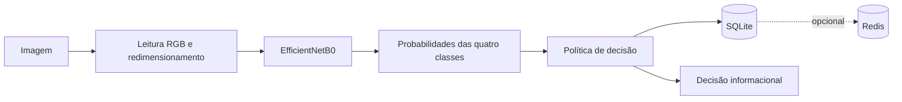
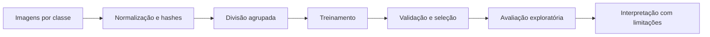
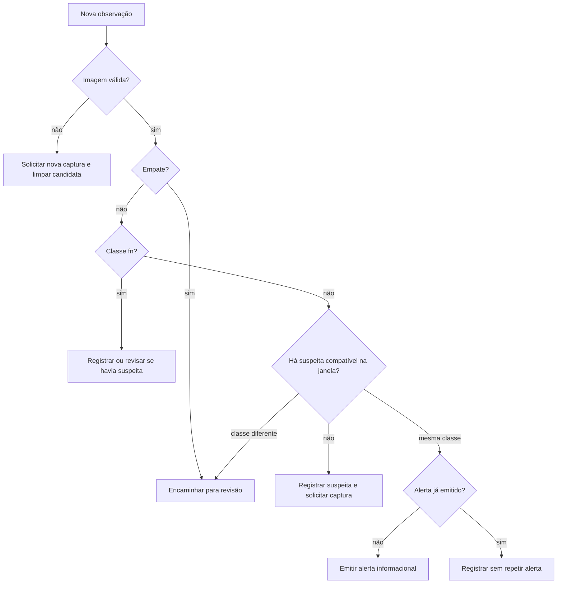

# Guia metodológico

Este documento descreve o que está implementado e preservado no repositório.
Regras do agente são hipóteses operacionais experimentais, não recomendações de
manejo nutricional.

## Problema e classes

O classificador separa imagens em quatro classes, na ordem registrada:

| Código | Interpretação usada no projeto |
| --- | --- |
| `def_k` | possível deficiência visual de potássio |
| `def_n` | possível deficiência visual de nitrogênio |
| `def_p` | possível deficiência visual de fósforo |
| `fn` | fertilização/nutrição completa na rotulagem do conjunto |

Uma classe prevista é uma categoria visual do modelo. Ela não confirma estado
agronômico, causa do sintoma nem recomendação de adubação.

## Arquitetura implementada

O adaptador real redimensiona para 224 × 224 com interpolação bilinear. O modelo
EfficientNet padrão recebe pixels RGB em 0–255 e contém seu próprio
reescalonamento. O agente não segmenta folhas e não usa TTA na inferência.

## Preparação e divisão

`scripts/preparar_base.py` percorre as classes originais, calcula SHA-256 e cria
nomes normalizados. `scripts/dividir_base.py` produz partições de treino,
validação e teste, preserva cópias idênticas no mesmo grupo e considera alguns
grupos visuais definidos manualmente. O manifesto registra a divisão.

Esses grupos não possuem identificação comprovada por planta ou sequência. Eles
reduzem alguns riscos óbvios, mas não demonstram independência biológica entre
as partições.

## Modelo e treinamento principal

O treinamento registrado usa EfficientNetB0 inicializada com pesos ImageNet,
entrada 224 × 224, Global Average Pooling, dropout 0,35 e camada softmax com
quatro saídas. Há aumento de dados, pesos por classe, AdamW, label smoothing,
parada antecipada e redução da taxa de aprendizado.

O processo possui duas fases:

1. treinamento inicial com a base convolucional congelada;
2. ajuste fino de parte das camadas, mantendo Batch Normalization congelada.

O modelo principal registrado foi escolhido pela menor perda de validação entre
as fases. Experimentos posteriores comparam configurações usando macro F1 de
validação, com perda como desempate. As sementes 123, 321 e 456 aparecem na
comparação exploratória de repetibilidade. A fixação de sementes melhora a
rastreabilidade, mas não garante determinismo bit a bit entre hardwares.

## Imagens sintéticas e recorte

Os experimentos `C_sinteticas_*` acrescentam cinco imagens sintéticas por classe
ao treino, mantendo validação e teste. Os manifestos e metadados são públicos,
mas as imagens não são distribuídas; a revisão agronômica permanece registrada
como pendente.

`preparar_fundo_uniforme.py` é uma etapa separada de recorte com `rembg`. Ela
preserva originais, partições e hashes e usa ambiente diferente. Não há evidência
de que o recorte produza melhor desempenho nem teste independente.

## Validação, seleção e avaliação

- históricos CSV registram métricas por época;
- arquivos `validacao.json` registram métricas no conjunto de validação;
- `resumo_validacao.json` compara configurações;
- `resumo_sementes.json` resume seis execuções em validação;
- pastas `avaliacao_teste` e `avaliacao_exploratoria_teste*` contêm consultas ao
  conjunto denominado teste.

Como esse teste foi consultado durante o desenvolvimento, seus resultados são
exploratórios. Não há avaliação independente final preservada.

## Política do agente

O estado é mantido por `planta_id` em SQLite. Cada análise também guarda uma
assinatura do conteúdo, o hash da captura e a decisão completa. O comportamento
principal é:

A janela padrão de 24 horas é provisória. Confirmação exige duas capturas com
hashes diferentes, mesma classe e mesma versão de modelo. Hashes diferentes não
garantem independência das imagens. Observações fora de ordem, capturas repetidas
e identificadores conflitantes são tratados explicitamente.

## Persistência e Redis

SQLite guarda estado por planta, análises e capturas utilizadas. A decisão é
persistida antes da tentativa opcional de publicação. Falhas de Redis mantêm a
análise pendente para nova tentativa. A entrega é “pelo menos uma vez”; o
consumidor deve deduplicar por `analise_id`. Não há garantia de execução única.

## Comparação das políticas

A referência imediata emite alerta para cada previsão válida de deficiência e
não guarda histórico. Ela é comparada com o agente sobre cinco percepções fixas:
quatro associadas a imagens de validação e uma entrada inválida. A comparação
verifica decisões e estado, mas não executa inferência.

O cenário registra quatro alertas na referência e um no agente. Isso demonstra
diferença operacional na sequência simulada. Sem rótulos longitudinais, não
mede falsos positivos, sensibilidade temporal, benefício de cultivo ou
superioridade agronômica.

## Formatos dos artefatos

| Formato | Conteúdo encontrado | Como interpretar |
| --- | --- | --- |
| CSV | manifestos, históricos, predições e matrizes | Tabelas inspecionáveis; confira cabeçalho, partição e proveniência. |
| JSON | configurações, protocolos, métricas e resumos | Registro estruturado de uma execução ou comparação. |
| JSONL | uma percepção/decisão por linha | Sequências funcionais do agente; ordem das linhas é relevante. |
| NPZ | rótulos e probabilidades NumPy | Saída binária pequena para reanálise; não contém o modelo. |
| PDF | matriz de confusão preservada | Visualização histórica; use os arquivos estruturados para auditoria numérica. |

Consulte a [matriz de rastreabilidade](RASTREABILIDADE.md) antes de citar qualquer
número isolado.
